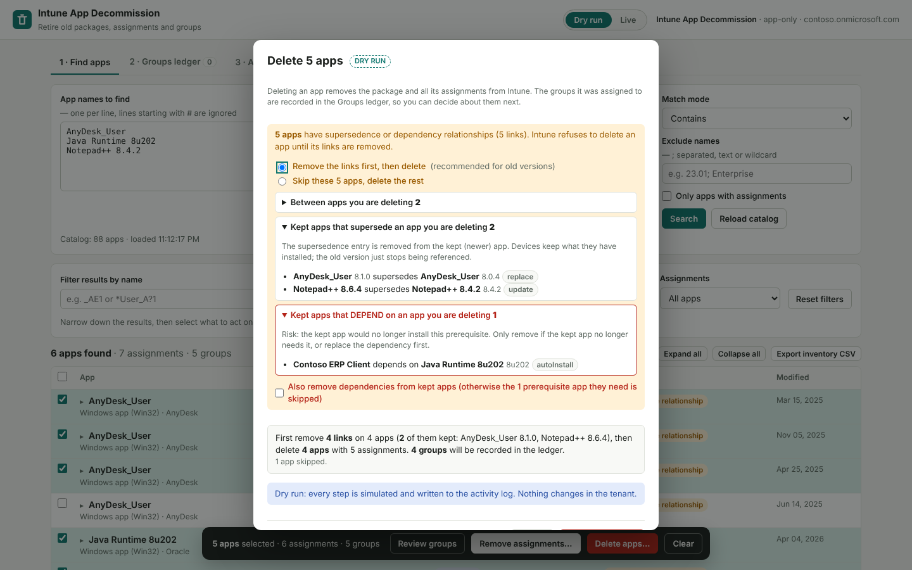
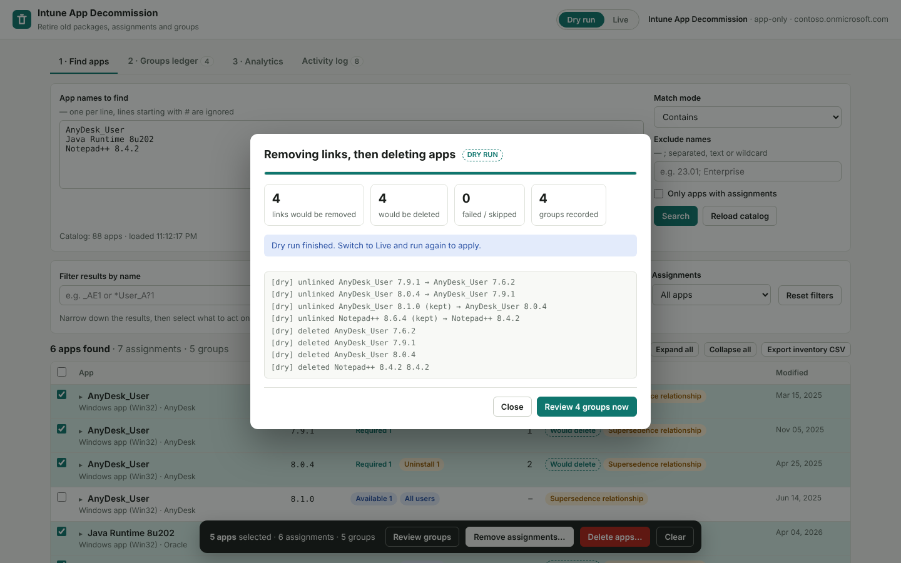
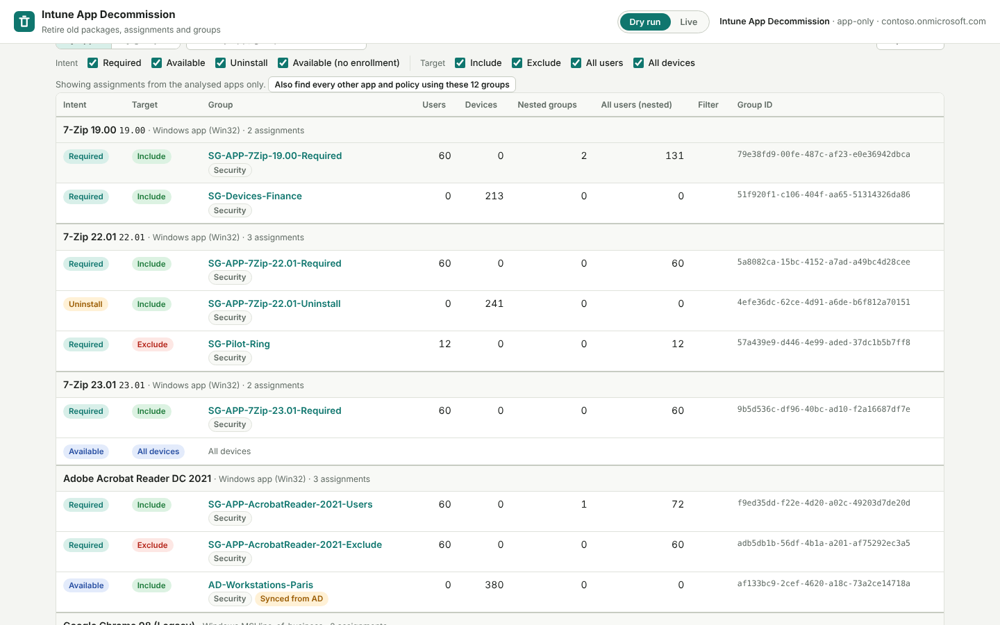
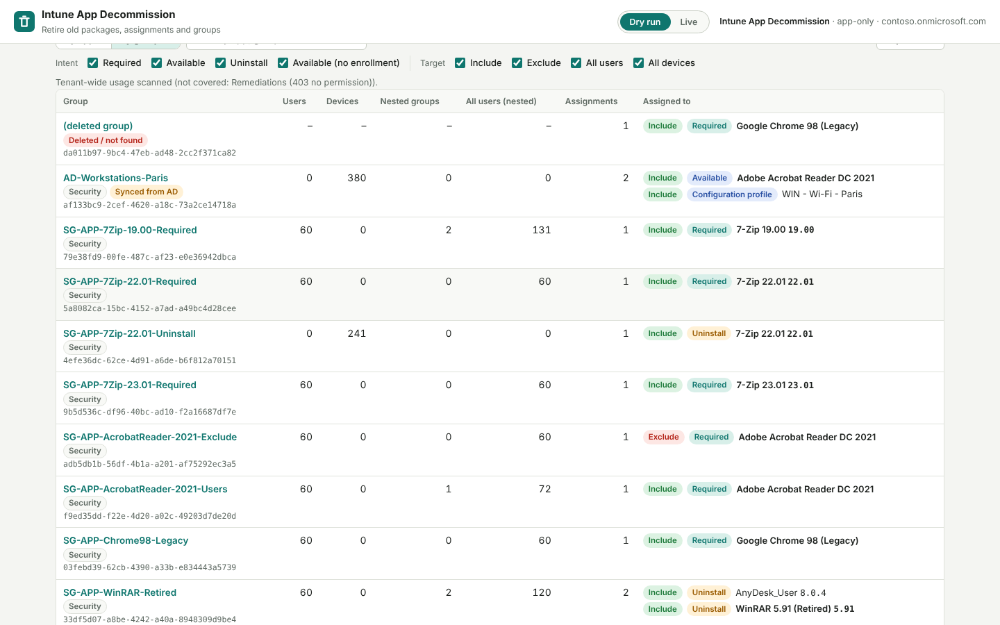
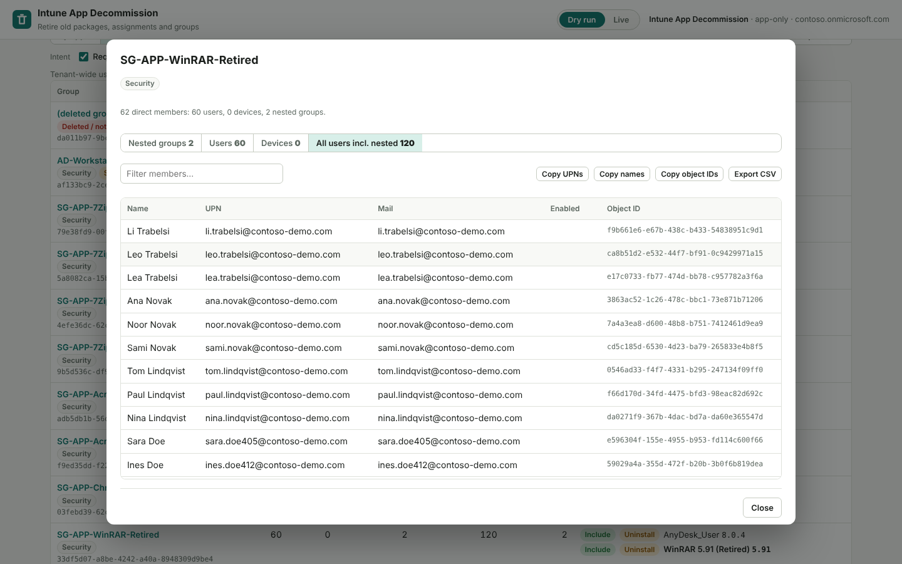
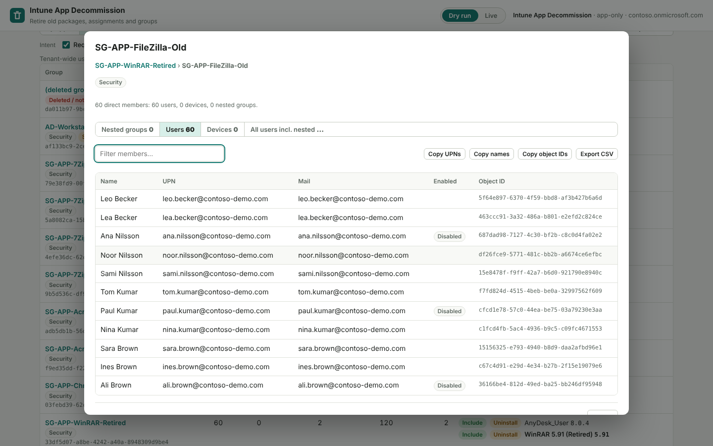
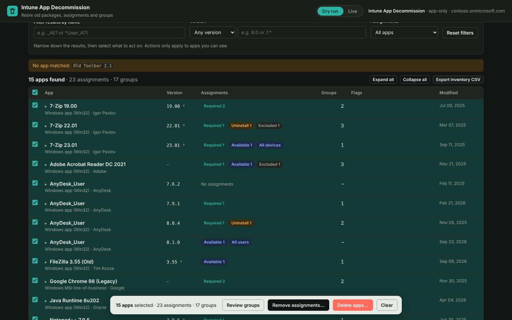

# Intune App Decommission

**Retire old Intune app packages in bulk — and clean up the Entra ID groups they leave behind — with a dry run before anything touches production.**

[](https://github.com/exentis-tech/intune-app-decommission/actions/workflows/ci.yml)


Over the years an Intune tenant collects hundreds of superseded packages — `7-Zip 19.00`, `7-Zip 22.01`, five builds of the same agent — each with its own assignment groups. Removing them one by one in the portal is slow and it's easy to delete a group that something else still uses. This tool does it in bulk, safely:

| Scenario | What happens |
|---|---|
| **Inspect** | Find many apps by name at once and see every assignment, group and version. Nothing changes. |
| **Remove assignments** | Apps stay in Intune; assignments are removed — all, or only certain intents, targets or group names. |
| **Delete apps** | The packages are deleted from Intune. |
| **Unlink and delete** | Old builds superseded by a newer one, or apps other apps depend on, are unlinked first (only the links are removed — the tool can never add one), then deleted. Risky dependencies need an explicit opt-in. |
| **Analyse** | For the apps you searched: every group per app — included / excluded, required / available / uninstall — with user, device and nested-group counts. Or search groups by name and see every app and policy they're assigned to. Drill into any group down to its nested users. |
| **Clean up groups** | Every group taken off an app is recorded in a **Groups ledger**. Check whether each one is still used anywhere, filter by name (`SG-APP-*`), then delete, keep, or decide later. |

Everything starts in **Dry run**, and the server can be locked to dry run from `config.json`.

## Features

- **Bulk search** — paste dozens of names; match by contains, exact, starts with, wildcard or regex; exclusions; lists names that matched nothing.
- **Supersedence & dependencies handled** — reads each app's relationships, shows which links block deletion and which kept apps they touch, removes them, then deletes. The JSON backup records every link before the change.
- **Analytics for forensics** — app × group × intent matrix, include/exclude, member counts, tenant-wide usage of any group, member drill-down through nested groups, CSV export of everything.
- **Version-aware** — shows each app's version and filters results by version (*older than 8.0*, *is 7.\**), so you can keep the newest build and retire the rest.
- **Granular assignment removal** — by intent (required / available / uninstall), target (included, excluded, all users, all devices) and group name pattern.
- **Groups ledger** — remembers which groups were assigned to which apps, with member counts, group type and AD-sync status; export/import as JSON or CSV.
- **Usage check** — before deleting a group, finds every app, configuration profile, settings catalog, compliance, ADMX, script, remediation and app configuration assignment that still uses it.
- **Dry run everywhere** — every action can be simulated and is written to the activity log.
- **Guard rails** — typed confirmations, automatic return to dry run, JSON backups, server-side allowlist of the only writes it can perform (three deletes, plus removing app relationships — never adding them), audit log on disk.
- **App-only auth from `config.json`** — the client secret stays in a local PowerShell process and never reaches the browser.
- **No dependencies** — one PowerShell script and a static web page. No modules to install, no telemetry.

## Requirements

| | |
|---|---|
| **Operating system** | Windows 10/11 or Windows Server 2016+ (macOS / Linux work with PowerShell 7) |
| **PowerShell** | Windows PowerShell 5.1 (.NET Framework 4.7.2+) or PowerShell 7.2+ |
| **Browser** | Current Edge, Chrome or Firefox |
| **Network** | HTTPS to `login.microsoftonline.com` and `graph.microsoft.com`, directly or through a proxy |
| **Entra ID** | An app registration with a client secret and admin-consented **application** permissions (below) |
| **Admin to consent** | Global Administrator or Privileged Role Administrator, once |
| **Port** | One free local port, `8088` by default |

### Microsoft Graph application permissions

| Permission | Required? | Used for |
|---|---|---|
| `DeviceManagementApps.ReadWrite.All` | **Yes** | Read apps, versions, assignments and relationships; remove assignments and relationships; delete apps |
| `Group.ReadWrite.All` | For group deletion | Read groups and their members, delete groups. Use `Group.Read.All` if you never delete groups |
| `DeviceManagementConfiguration.Read.All` | Recommended | Check whether groups are still used by policies, scripts and remediations |
| `Organization.Read.All` | Optional | Show the tenant's domain name in the UI |

Full details: [docs/REQUIREMENTS.md](docs/REQUIREMENTS.md)

## Quick start

```powershell
git clone https://github.com/exentis-tech/intune-app-decommission.git
cd intune-app-decommission
Copy-Item config.example.json config.json
notepad config.json        # fill in TenantId, ApplicationId, ClientSecret
.\Start-Decommission.cmd   # or: pwsh ./server.ps1
```

The browser opens on `http://127.0.0.1:8088/`.

```
  Intune App Decommission  v1.0.0

[14:27:15] Config:        C:\Tools\intune-app-decommission\config.json
[14:27:15] Tenant:        contoso.onmicrosoft.com
[14:27:15] Application:   11111111-2222-3333-4444-555555555555
[14:27:15] Signed in as:  Intune App Decommission
[14:27:15] Permissions:   DeviceManagementApps.ReadWrite.All, Group.ReadWrite.All, DeviceManagementConfiguration.Read.All
[14:27:15] Real deletes:  disabled (EnableRealDelete=false). The UI runs in dry run only.
[14:27:15] Open:          http://127.0.0.1:8088/
[14:27:15] Press Ctrl+C to stop.
```

Keep `"EnableRealDelete": false` until a dry run gives you exactly what you expect, then set it to `true` and restart.

Step-by-step app registration, configuration and troubleshooting: **[docs/SETUP.md](docs/SETUP.md)**

## Configuration

`config.json` (copy from [`config.example.json`](config.example.json)):

| Key | Default | Meaning |
|---|---|---|
| `TenantId` | — | Tenant ID or primary domain |
| `ApplicationId` | — | App registration (client) ID |
| `ClientSecret` | — | Client secret. Or leave it out and set the `IAD_CLIENT_SECRET` environment variable |
| `GraphBaseUrl` | `https://graph.microsoft.com/v1.0` | Graph v1.0 endpoint |
| `GraphBetaBaseUrl` | `https://graph.microsoft.com/beta` | Graph beta endpoint (Intune apps) |
| `AuthorityHost` | `https://login.microsoftonline.com` | *Optional*, for national clouds |
| `ListenPrefix` | `http://127.0.0.1:8088/` | Local address of the UI. Must be loopback |
| `AllowedOrigin` | empty | Only if another web origin must call the local API. `*` is ignored on purpose |
| `EnableRealDelete` | `false` | Master switch for every write (deletes and relationship removal). `false` = dry run only, enforced by the server |
| `RequestTimeoutSeconds` | `60` | Timeout for each Graph call |
| `ProxyUrl` | empty | Outbound proxy, e.g. `http://proxy.corp:8080` |
| `UseDefaultProxyCredentials` | `false` | Authenticate to the proxy as the current Windows user |

> `config.json` and `logs/` are git-ignored. Never commit a client secret; if one leaks, rotate it in Entra ID immediately.

## How it works

```
 Browser UI ──(session token)──► server.ps1 on 127.0.0.1 ──(app-only token)──► Microsoft Graph
                                  · reads config.json
                                  · read allowlist, 3 allowed deletes
                                  · EnableRealDelete gate
                                  · logs/audit-<date>.jsonl
```

Design and threat model: [docs/SECURITY-MODEL.md](docs/SECURITY-MODEL.md)

## Screenshots

| | |
|---|---|
|  **Find many apps at once** |  **Filter results by version** |
|  **Every assignment, group and filter** |  **Groups behind the selected apps** |
|  **Remove only what matches** |  **Dry run first** |
|  **Typed confirmation in live mode** |  **Groups ledger with usage check** |
|  **In-use and synced groups are skipped** |  **Every write logged** |
|  **Supersedence and dependency links, explained** |  **Links removed, then apps deleted** |
|  **Analytics — every group per app** |  **Analytics — everything a group is assigned to** |
|  **Members, including nested users** |  **Drill into nested groups** |
|  **Locked to dry run by config.json** |  **Dark mode** |

Walkthrough of every screen: [docs/USER-GUIDE.md](docs/USER-GUIDE.md)

## Limitations

- Uses Microsoft Graph **beta** endpoints for Intune apps, which Microsoft can change.
- The usage check does **not** cover Conditional Access, app protection policies, enrollment / Autopilot profiles, Windows update profiles, or anything outside Intune.
- Relationship removal uses the Graph beta `updateRelationships` action. Removing a dependency from an app you keep changes how that app installs — the tool only does it when you opt in.
- VPP and Managed Google Play apps can be re-synced from the store if they're still licensed there.
- Deleted Microsoft 365 groups can be restored for 30 days. Treat security group deletion as permanent.
- The local server handles one request at a time; very large tenants take a little longer to scan.

## Documentation

- [Requirements](docs/REQUIREMENTS.md)
- [Setup & troubleshooting](docs/SETUP.md)
- [User guide](docs/USER-GUIDE.md)
- [Security model](docs/SECURITY-MODEL.md)
- [Changelog](CHANGELOG.md) · [Contributing](CONTRIBUTING.md) · [Security policy](SECURITY.md)

## Part of the Exentis Intune toolkit

Built and maintained by [Marwen Mahmoud](https://github.com/exentis-tech) — see also the other Intune tools on [github.com/exentis-tech](https://github.com/exentis-tech).

## License

[MIT](LICENSE). Provided as is, without warranty — always dry-run first and review what a live action will change.
