# User guide

The screenshots use a fictitious *Contoso* tenant.

- [The header: Dry run and Live](#the-header-dry-run-and-live)
- [1. Find apps](#1-find-apps)
- [2. Filter the results](#2-filter-the-results)
- [3. Inspect assignments and groups](#3-inspect-assignments-and-groups)
- [4. Remove assignments](#4-remove-assignments)
- [5. Delete apps](#5-delete-apps)
- [6. Groups ledger](#6-groups-ledger)
- [7. Delete groups](#7-delete-groups)
- [8. Activity log and audit log](#8-activity-log-and-audit-log)
- [Typical decommissioning run](#typical-decommissioning-run)

## The header: Dry run and Live

The switch in the top-right decides whether actions are simulated (**Dry run**, default) or written to the tenant (**Live**).

- With `"EnableRealDelete": false` in `config.json`, **Live is greyed out** and a banner says so. The server refuses deletes even if the UI were bypassed.

  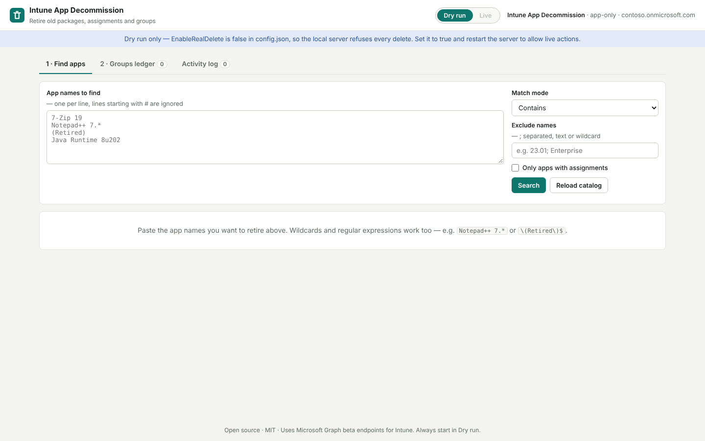

- With `"EnableRealDelete": true`, switching to Live asks you to type the first part of your tenant domain. A red frame and banner stay visible while Live is on. By default the UI returns to Dry run after each live action.

  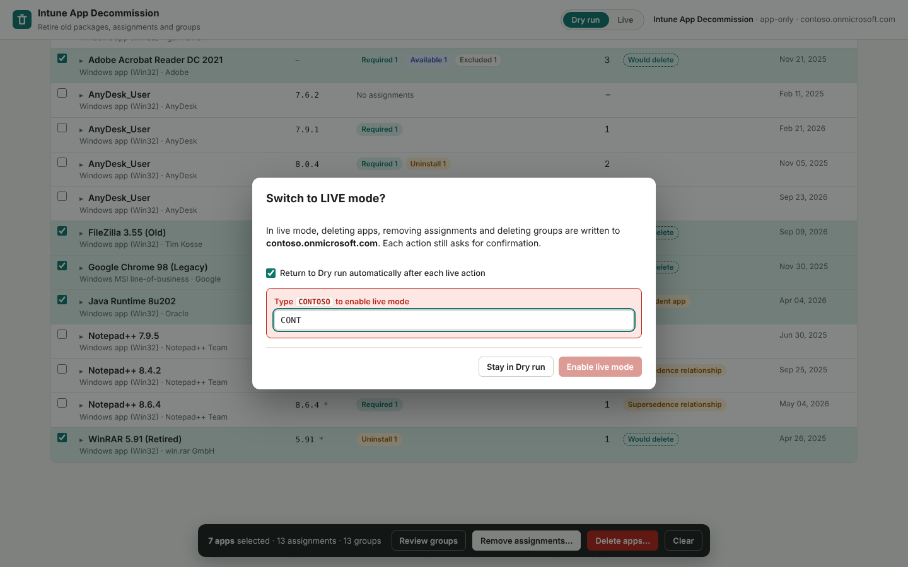

## 1. Find apps

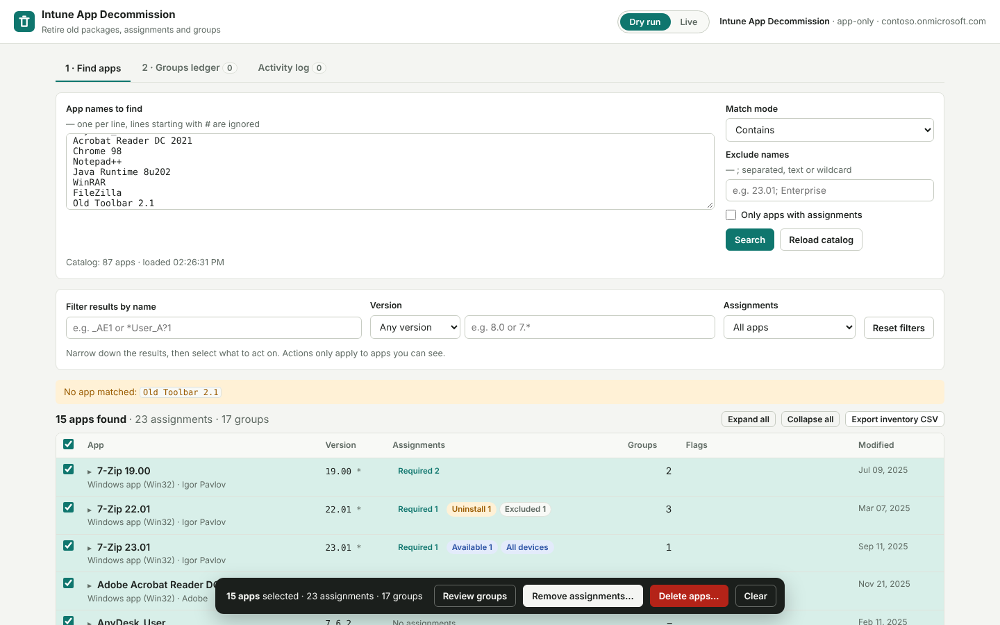

- **App names to find** — one per line. Lines starting with `#` are ignored, so you can keep notes in the list.
- **Match mode** — applies to every line:

  | Mode | Example | Matches |
  |---|---|---|
  | Contains | `7-Zip` | `7-Zip 19.00`, `7-Zip 22.01` |
  | Exact name | `PuTTY 0.76` | only that app (case-insensitive) |
  | Starts with | `Adobe Acrobat` | `Adobe Acrobat Reader DC 2021` |
  | Wildcard | `Notepad++ 7.*` | `Notepad++ 7.9.5` |
  | Regular expression | `\(Retired\)$` | names ending in `(Retired)` |

- **Exclude names** — `;`-separated text or wildcards removed from the matches, e.g. `23.01; Enterprise`.
- **Only apps with assignments** — skip apps that aren't assigned to anything.
- **Reload catalog** — the app list is loaded once and cached; reload after changes made elsewhere.

Names that matched nothing are listed in a yellow bar so typos stand out.

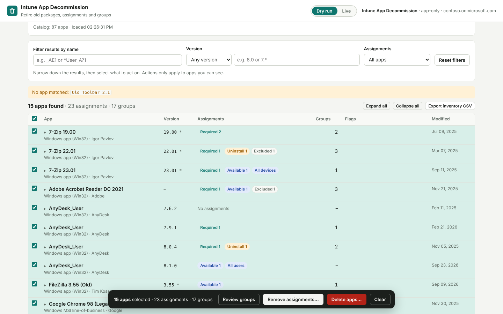

Each row shows the app, its **version**, an assignment summary (*Required 2*, *Uninstall 1*, *Excluded 1*, *All users*…), the number of groups, flags and the last-modified date.

**Version** comes from the app itself (display version for Win32 apps, product version for MSI, version fields for mobile and macOS apps). If an app has none, it is read from its name and marked with `*`.

**Flags:**

| Flag | Meaning |
|---|---|
| *Supersedence relationship* / *n dependent apps* | Intune won't delete the app until the relationship is removed in the portal |
| *Synced from store* | VPP or Managed Google Play — remove it from the store too, or it may come back |
| *Would delete*, *Deleted*, *Assignments removed* | Result of the last dry or live action on this app |

## 2. Filter the results

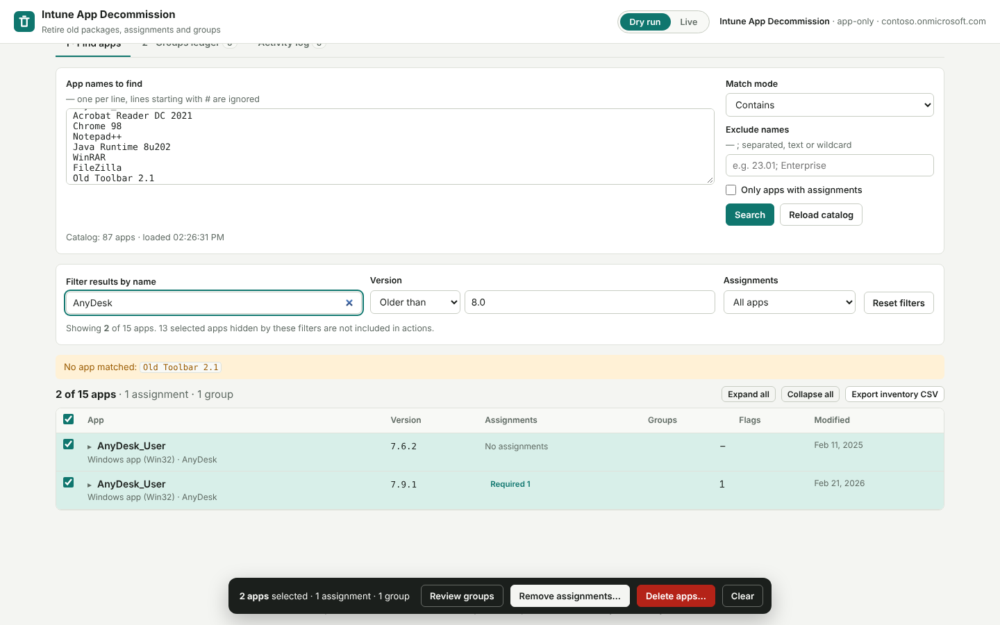

With many results, narrow them down before selecting:

- **Filter results by name** — text or wildcard, e.g. `_AE1` or `*User_A?1`.
- **Version** — *Is* (wildcards allowed: `7.*`), *Contains*, *Older than*, *Up to*, *Newer than*, *From*, or *No version*. Versions are compared numerically: `8.10` is newer than `8.9`.
- **Assignments** — all, with assignments, or without.

**Actions only apply to apps you can see.** If selected apps are hidden by a filter, the line under the filters says how many — they are not included in Review, Remove or Delete. *Select all* and *Expand all* act on visible rows, and *Export inventory CSV* exports the visible rows.

## 3. Inspect assignments and groups

Click ▸ next to an app to see each assignment: intent, target type, group name and ID, and assignment filter.

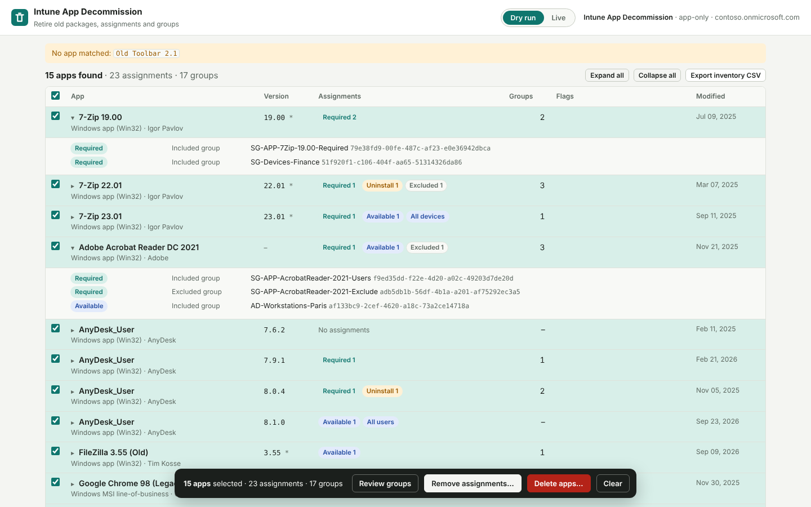

Select apps and click **Review groups** in the bottom bar for a read-only list of every group behind them, with member counts, group type (Security, Microsoft 365, Dynamic, Synced from AD, Role-assignable) and which app uses it how.

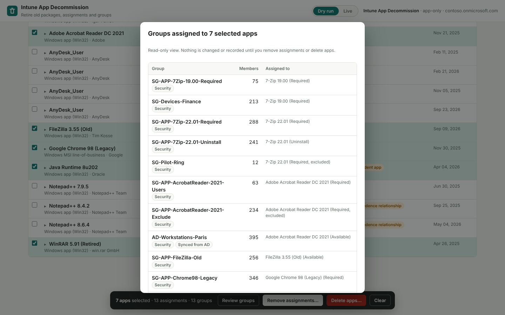

## 4. Remove assignments

**Remove assignments…** keeps the apps and removes their assignments.

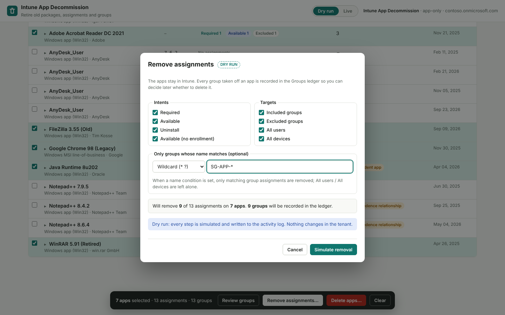

- **Intents** — Required, Available, Uninstall, Available without enrollment.
- **Targets** — Included groups, Excluded groups, All users, All devices.
- **Only groups whose name matches** — optional pattern, e.g. `SG-APP-*`. When set, only matching group assignments are removed; *All users* / *All devices* are left alone.

The preview shows how many assignments on how many apps will go, and how many groups will be recorded in the ledger. Apps where nothing matches are skipped.

## 5. Delete apps

**Delete apps…** deletes the packages and, with them, all their assignments. Their groups are recorded in the ledger first.

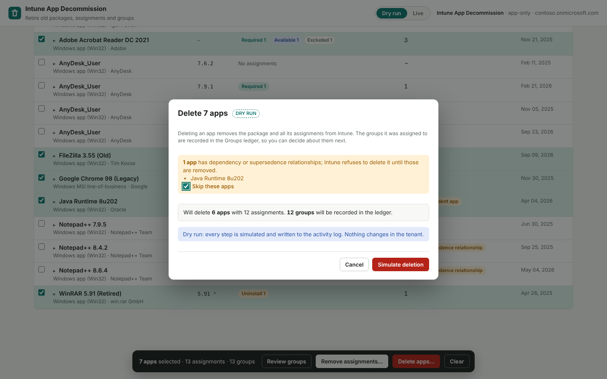

Apps with dependency or supersedence relationships are listed and skipped by default.

In Live mode you type `DELETE` to confirm, and can download a JSON backup of the apps and their assignments (with group names) first.

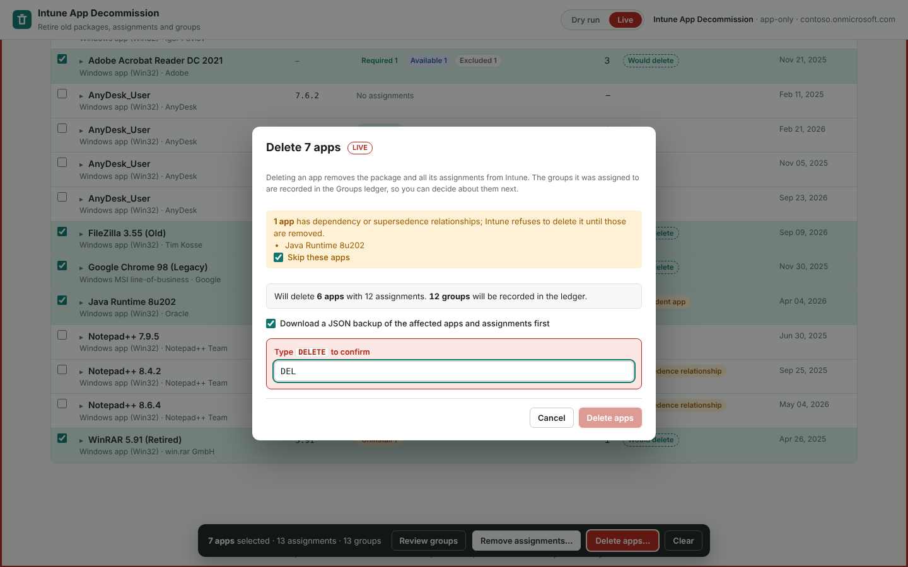

When the run finishes you see what was done, what failed and how many groups were recorded, with a shortcut to review them.

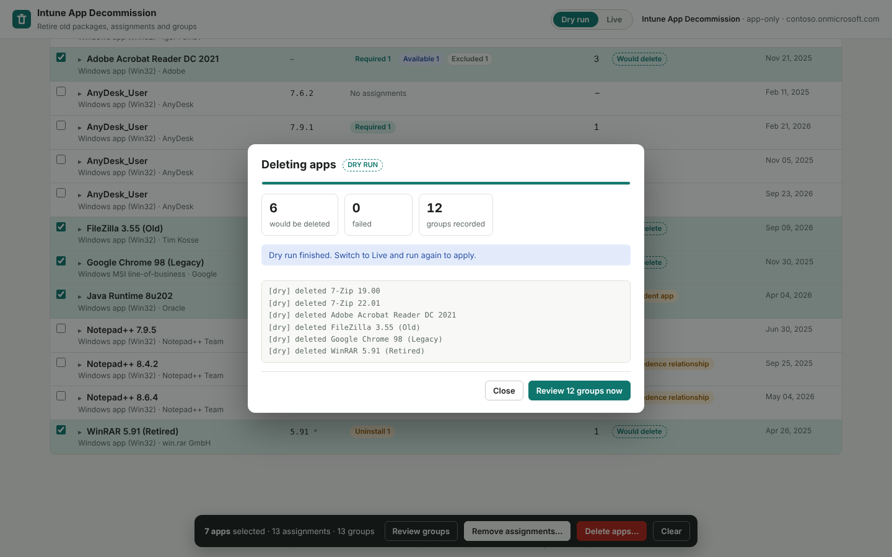

Deleted apps stay greyed out in the results until the next search.

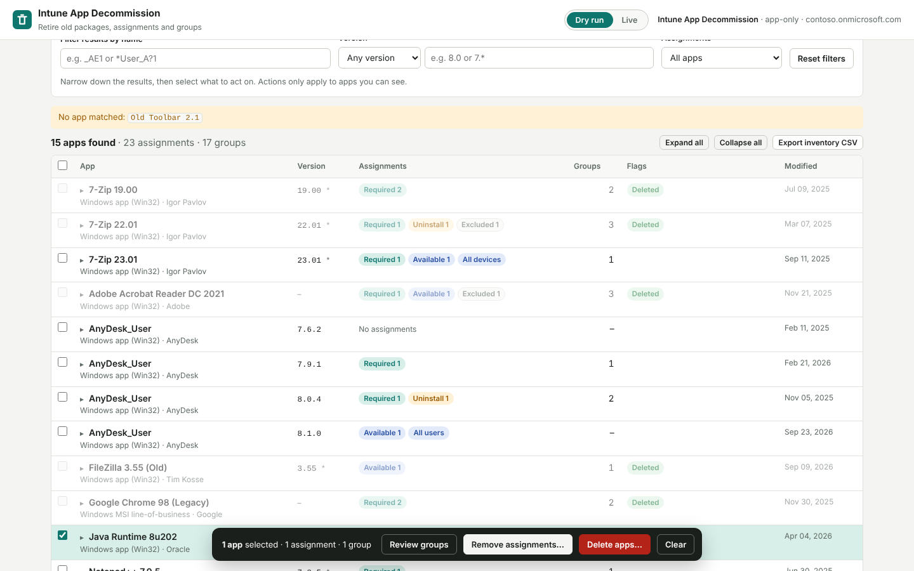

## 6. Groups ledger

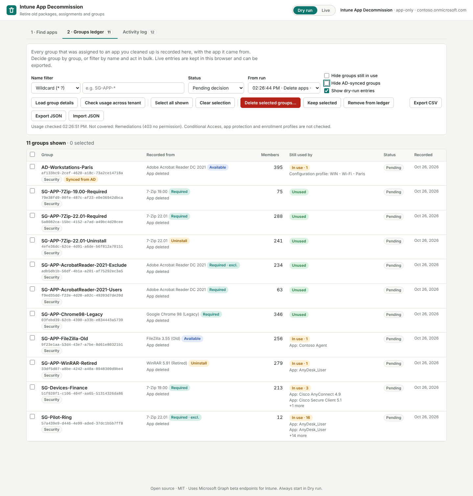

Every group taken off an app — by removing an assignment or deleting the app — is recorded with the app, intent and run it came from. Nothing is deleted until you decide.

- **Load group details** — type, member count, sync status. Loaded automatically after each run.
- **Check usage across tenant** — searches all app, configuration profile, settings catalog, compliance, administrative template, platform script, remediation and app configuration assignments. *Unused* or *In use · n* (hover for the list). Anything it couldn't read is named under the toolbar.
- **Filters** — name (wildcard / regex), status (*Pending decision*, *Deleted*, *Kept*, *Failed*), the run it came from, hide groups still in use, hide AD-synced groups, show/hide dry-run entries.
- **Keep selected** — mark groups you want to keep; they leave the *Pending* view.
- **Remove from ledger** — forget entries in this tool (nothing changes in Entra ID).
- **Export CSV / JSON**, **Import JSON** — move the ledger between machines or keep it with your change record.

Entries recorded in a dry run are tagged *dry run* and can't be deleted in Live mode, because their assignment still exists. The live ledger is saved per tenant in the browser.

## 7. Delete groups

Filter (e.g. `SG-APP-*`), **Select all shown**, then **Delete selected groups…**

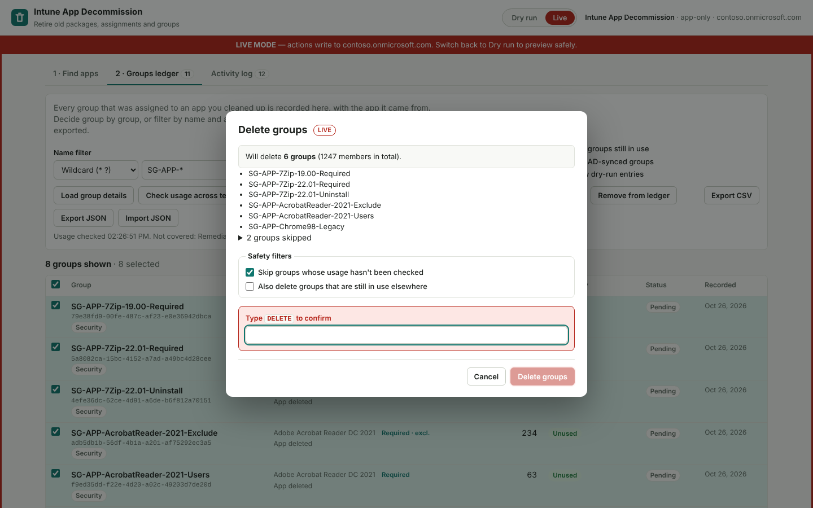

Skipped automatically, listed under *groups skipped*:

- groups synced from on-premises AD;
- groups still in use elsewhere — unless you tick *Also delete groups that are still in use*;
- groups whose usage hasn't been checked — unless you untick that safety filter;
- dry-run entries, when in Live mode;
- groups already deleted.

Microsoft 365 and role-assignable groups get an extra warning. Afterwards the ledger shows each group's status:

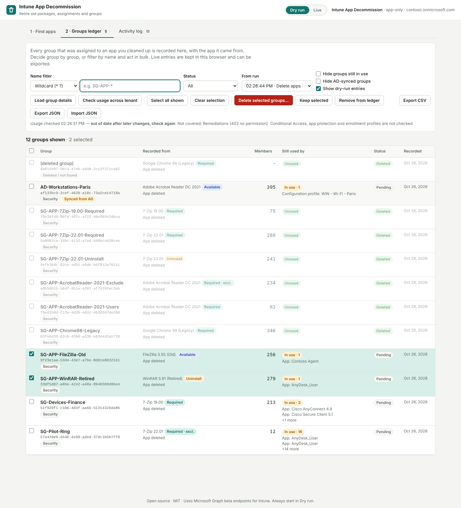

## 8. Activity log and audit log

**Activity log** lists every write in the browser session — mode (DRY / LIVE), action, target, the exact Graph call and the result — and exports to CSV.

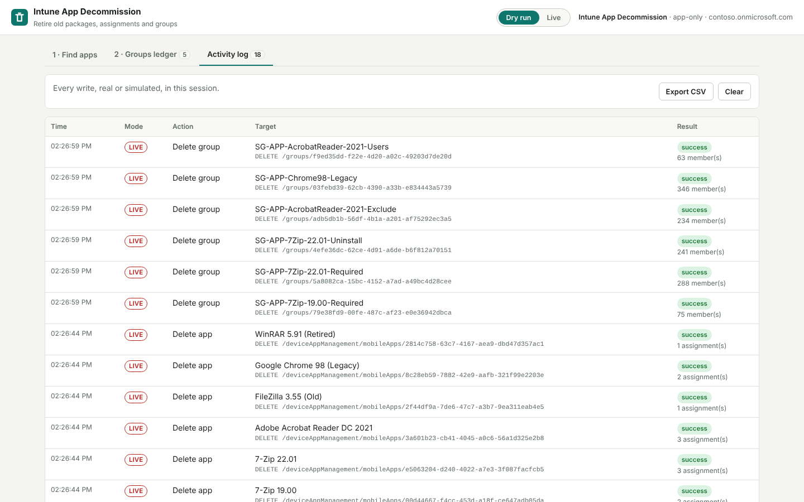

The server keeps the permanent record in `logs/audit-YYYY-MM-DD.jsonl`, one JSON line per delete attempt, including blocked ones:

```json
{"tenantId":"contoso.onmicrosoft.com","method":"DELETE","path":"/groups/79e38fd9-…","status":204,"result":"success","at":"2026-10-26T14:26:59+01:00"}
{"tenantId":"contoso.onmicrosoft.com","method":"DELETE","path":"/groups/abc…","result":"blocked","reason":"EnableRealDelete=false","at":"…"}
```

## Typical decommissioning run

1. Start with `EnableRealDelete: false`.
2. Search the products you're retiring; filter out the versions you keep (*Older than* the current build).
3. **Export inventory CSV** and attach it to your change request.
4. **Delete apps…** (or **Remove assignments…** if you want a grace period) in dry run; check the summary.
5. **Groups ledger → Check usage across tenant**; review in-use groups.
6. Set `EnableRealDelete: true`, restart, switch to Live, repeat step 4 with a backup.
7. Ledger: filter your naming convention (`SG-APP-*`), delete unused groups, mark the rest as *Kept*.
8. Export the ledger and the activity log; keep `logs/audit-*.jsonl`.
9. Set `EnableRealDelete` back to `false`.
